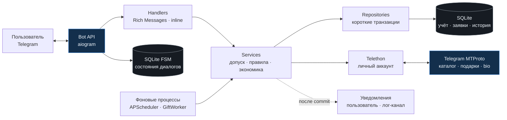

<div align="center">

<sub>T E L E G R A M &nbsp; · &nbsp; S T A R S &nbsp; H U B</sub>

# SIRIUS

**Персональный маршрут, внутренние награды и Telegram-подарки.**

Нативные карточки. Точный учёт. Управляемая выдача.

<br>


<br>

[Запуск](docs/DEPLOY.md) &nbsp; · &nbsp; [Выдача подарков](docs/STAGE7.md) &nbsp; · &nbsp; [Учёт средств](docs/EXACT_MONEY.md) &nbsp; · &nbsp; [Передача проекта](HANDOFF.md)

</div>

---

SIRIUS объединяет ежедневные активности, рефералов, задания и выдачу обычных
Stars-подарков в одном Telegram-боте. Пользователь видит следующий доступный шаг;
владелец управляет экономикой, очередью и результатами из нативной админки.

## Опыт внутри Telegram

**«Мой день»** собирает бонус, бесплатное вращение, доступные клики и новые
задания. Главное меню показывает баланс, уровень и команду. Переходы обновляют
сообщение на месте; незавершённый диалог очищается при смене раздела.

Общий слой Rich Messages оформляет заголовки, таблицы показателей и
раскрывающиеся условия. Ссылки копируются одной кнопкой, завершённые действия
используют неактивные кнопки. Напоминания включаются самим пользователем;
дневные лимиты и даты рассчитываются по Москве.

| Для пользователя | Для владельца |
|---|---|
| **Ежедневный маршрут** — бонус с серией, кликер, уровни и колесо с подтверждением платного вращения | **Экономика** — награды, лимиты и условия в `settings`, редактирование без передеплоя |
| **Команда и задания** — личная реферальная ссылка, подтверждённые друзья, подписки на спонсоров | **Спонсоры и партнёры** — каналы, лимиты, UTM-ссылки, CPA и партнёрские заявки |
| **Прогресс** — достижения, рейтинг и еженедельные награды | **Контроль активности** — дашборд, перепроверка подписок и откат связанных наград |
| **Подарки** — актуальный каталог, условия, подтверждение, номер заявки и история | **Выдача** — очередь, ожидание, бюджет, попытки и сверка с источником подтверждения |
| **Обратная связь** — FAQ, поддержка с перепиской, отзывы и инструкции | **Коммуникация** — модерация, тикеты, рассылки с прогрессом и дайджесты |
| **Личный счёт** — история операций, промокоды и настройки уведомлений | **Эксплуатация** — журнал средств, зашифрованные бэкапы, алерты и health/readiness |

Интерфейс использует текст и inline-кнопки. Оформление зависит от Telegram-клиента
и его темы; при известном отсутствии Rich API предусмотрен HTML-режим.

## Подарок: от выбора до подтверждения

Обычные Stars-подарки отправляет **личный Telegram-аккаунт через Telethon**.
Получателем становится текущий пользователь бота: сервер проверяет его ID после
разрешения аккаунта. Для пользователя без username предусмотрен путь через
доступный отправителю `InputPeer` и подсказка о следующем шаге.

### Три отдельных слоя средств

| Слой | Что означает | Как учитывается |
|---|---|---|
| **Внутренний баланс** | Обязательство бота перед пользователем | Целые доли: `1 единица = 10 000`; начисление сначала погашает долг |
| **Резерв заявки** | Часть внутреннего баланса, выделенная под выбранный подарок | Один резерв; однократное потребление либо возврат с записью в журнале |
| **Stars отправителя** | Настоящие Stars на личном Telegram-аккаунте | Читаются через MTProto; пополняются владельцем, расходуются в пределах дневного бюджета |

Начисление внутри SIRIUS не пополняет Telegram-аккаунт. Правила округления,
аудит перехода с Float и финансовые инварианты описаны в
[точном учёте](docs/EXACT_MONEY.md).

Настоящие оплаты **выключены по умолчанию**: `gifts.enabled=false`,
`gifts.daily_budget_stars=0`. Владелец назначает бюджет и включает выдачу отдельно.

### Четыре шага выдачи

| Шаг | Что фиксирует система |
|---|---|
| **01 · Предложение** | Актуальную цену и доступность; подтверждение действует две минуты |
| **02 · Резерв** | Допуск, долг, баланс, друзей и лимит; уникальную заявку, резерв и операцию в одной короткой транзакции |
| **03 · Очередь** | Владение заявкой одним воркером; повторную проверку цены, бюджета и реальных Stars перед оплатой |
| **04 · Подтверждение** | Результат Telegram либо ручное решение владельца с основанием, подтверждением и аудитом |

Сетевые вызовы выполняются после закрытия транзакций. Отсутствие Stars, бюджета
или доступной сессии сохраняет заявку в ожидании. Ожидающую заявку можно отменить;
во время обработки отмена закрыта. Подтверждённая выдача потребляет резерв один раз.

> **Если исход оплаты неизвестен**, заявка переходит в
> `reconciliation_required`: резерв сохраняется до сверки. Автоматическая
> повторная покупка и возврат запрещены. Telegram API не предоставляет для этого
> маршрута контракт exactly-once внешней оплаты.

Цена, время, получатель или изменение баланса сами по себе не доказывают оплату
конкретной заявки. Доступные статусы, восстановление lease, FloodWait и правила
ручных решений разобраны в [отчёте этапа 7](docs/STAGE7.md).

## Архитектура



`handlers → services → repositories` отделяет представление от правил и записи
данных. Внутренний денежный журнал изменяется вместе со счётом. Проверки
ban/shadow-ban/deleted действуют в сервисах и финансовых репозиториях, включая
прямой вызов. Сессии Telethon хранятся в БД в шифровании Fernet; FSM переживает
рестарт. Логи — structlog JSON, `/health` и `/ready` — отдельные HTTP-проверки.

<details>
<summary><strong>Закреплённый стек и ориентиры в коде</strong></summary>

<br>

| Слой | Компоненты |
|---|---|
| Runtime | Python **3.14.7**, Docker multi-stage |
| Telegram | aiogram **3.31.0**, Telethon **1.45.0** |
| Данные | SQLAlchemy asyncio **2.1.1**, aiosqlite **0.22.1**, Alembic **1.20.0** |
| Конфигурация | Pydantic **2.13.5**, pydantic-settings **2.15.0** |
| Сеть и задачи | aiohttp **3.14.3**, APScheduler **3.11.3** |
| Шифрование и логи | cryptography **50.0.2**, structlog **26.1.0** |
| Проверки | pytest **9.1.1**, pytest-asyncio **1.4.0** |

[requirements.txt](requirements.txt) и
[requirements-dev.txt](requirements-dev.txt) фиксируют прямые зависимости;
lock-файлы фиксируют транзитивные пакеты и SHA256. Docker устанавливает их с
`--require-hashes`.

| Путь | Ответственность |
|---|---|
| [bot/](bot/) · [locales/ru.py](locales/ru.py) | Telegram-сценарии, клавиатуры и тексты |
| [services/](services/) · [db/repositories/](db/repositories/) | Бизнес-правила, изменения данных и учёт |
| [userbot/](userbot/) · [workers/](workers/) | MTProto-адаптер, выдача и фоновые процессы |
| [migrations/](migrations/) · [tests/](tests/) | Версии схемы и изолированные проверки |

</details>

## Запуск в Docker

Нужны Docker с Compose, токен бота и Telegram ID владельца. Для служебных
уведомлений и бэкапов подготовьте приватный лог-канал с ботом-администратором.
Локальный Python не требуется.

**1. Подготовьте конфигурацию** в PowerShell:

```powershell
if (-not (Test-Path -LiteralPath .env)) { Copy-Item .env.example .env }
docker compose build bot
docker compose run --rm -T --no-deps --volume "${PWD}/.env:/setup.env" --volume "${PWD}/scripts/init_env.py:/setup.py:ro" --entrypoint python bot /setup.py /setup.env
```

Помощник сохраняет новый Fernet-ключ прямо в `.env`, не показывая его. Существующий ключ сохраняется. Заполните остальные поля `.env`:

```dotenv
BOT_TOKEN=<токен из BotFather>
OWNER_ID=<Telegram ID владельца>
LOG_CHANNEL_ID=<ID приватного лог-канала>
# FERNET_KEY уже сохранён помощником; сохраните его при обновлениях.
```

Ключ храните отдельно от резервных копий. При обновлении существующей установки
сохраните прежний ключ и сначала создайте консистентный зашифрованный бэкап через
SQLite backup API. Порядок обновления и восстановления — в
[DEPLOY.md](docs/DEPLOY.md).

**2. Запустите один экземпляр бота:**

```powershell
docker compose up -d bot
Invoke-RestMethod http://127.0.0.1:8080/health
Invoke-RestMethod http://127.0.0.1:8080/ready
docker compose logs --tail 100 bot
```

Entrypoint применяет `alembic upgrade head` до polling. Runtime-процесс работает
как uid `10001`; health-порт опубликован только на `127.0.0.1`. Не запускайте
параллельный polling для того же токена.

<details>
<summary><strong>Подключение личного аккаунта отправителя</strong></summary>

<br>

API-данные получаются на [my.telegram.org](https://my.telegram.org).
В локальном `.env` заполните:

```dotenv
TG_API_ID=<API ID>
TG_API_HASH=<API hash>
USERBOT_PHONE=<номер выбранного аккаунта>
```

Вход выполняется при остановленном боте, в интерактивном терминале:

```powershell
docker compose stop bot
docker compose run --rm bot python -m userbot.login
```

Код Telegram и пароль 2FA вводятся скрыто в этом терминале. После проверки входа
закрепите показанный ID отправителя как `USERBOT_ACCOUNT_ID` в локальном `.env`.
`OWNER_ID` определяет владельца админки и может относиться к другому аккаунту.
Затем запустите бот:

```powershell
docker compose up -d bot
```

Проверьте авторизацию, выбранного отправителя, актуальный каталог и настоящий
Stars-баланс. Оплату включает владелец после назначения дневного бюджета.
Пополнение Stars также остаётся операцией владельца. Платная приёмка требует
отдельного решения с точным получателем и пределом расходов.

</details>

## Проверки и границы готовности

Проверенный срез **03.10.2026**; подробные результаты — в
[STAGE7.md](docs/STAGE7.md).

| Проверка | Подтверждённый результат |
|---|---|
| Полный suite локального дерева | **377 passed** |
| Отдельный чистый Git tree `dc4bf02` | **279 passed** |
| Миграции на изолированной копии | `0013 → 0015 → 0013 → 0015`; исходные значения сохранены, `integrity=ok`, FK-ошибок нет |
| Сборка и статические проверки | Runtime build, `pip check`, `compileall`, Ruff E9/F401/F841 для этапа 7, Compose config и `git diff --check` пройдены |
| Чтение Telegram | Авторизация отправителя подтверждена; каталог **151** подарок, **11** обычных доступны по текущему адаптеру |

Тесты запускаются в отдельном Docker test-stage: фиктивная конфигурация,
изолированные SQLite, отключённая сеть, read-only root и временный `/tmp`.
Production `.env` и рабочие volumes им не передаются.

```powershell
docker compose -f docker-compose.test.yml build test
docker compose -f docker-compose.test.yml run --rm test
```

**Реальные платные выдачи и отображение карточек в Telegram-клиентах ещё не
проверялись.** Каталог и чтение аккаунта не заменяют платную приёмку. Реализован
обычный Stars-процесс; resale, TON и аукционы в него не входят. Полный этап 12
с риск-скорингом, миссии и сезоны остаются отдельной будущей работой.

## Документация

| Документ | Когда открыть |
|---|---|
| [Развёртывание и эксплуатация](docs/DEPLOY.md) | Первый запуск, обновление, мониторинг и восстановление |
| [Выдача подарков · этап 7](docs/STAGE7.md) | Очередь, статусы, неизвестные оплаты, бюджет и платная приёмка |
| [Точный учёт средств](docs/EXACT_MONEY.md) | Целые доли, округление, долги, резервы, журнал и защита отката |
| [Модернизация интерфейса](docs/MODERNIZATION.md) | Rich Messages, «Мой день», напоминания и проверки 01.10.2026 |
| [Передача проекта](HANDOFF.md) | Текущий срез и история решений; актуальный блок находится в начале |
| [Исходная спецификация](docs/SPEC.md) | Первоначальные требования; текущий объём сверяется с этапом 7 |
| [Промпт продолжения](docs/NEXT_CHAT_PROMPT.md) | Контекст следующего чата; исторические факты требуют актуализации |

---

<div align="center">

<sub><strong>SIRIUS</strong> &nbsp; · &nbsp; Stars Hub &nbsp; · &nbsp; Native Telegram</sub>

</div>
