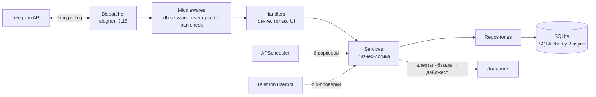

<div align="center">

# ✦ SIRIUS ✦

### Stars Hub — Telegram-бот для заработка Telegram Stars

*Рефералы · Задания · Кликер · Колесо фортуны · Ежедневный бонус · Вывод подарками*

<br>


<br>

**Премиум-UX внутри Telegram: только inline-кнопки, edit-in-place навигация как в SPA,<br>
единая дизайн-система «SIRIUS Elite» на всех экранах.**

</div>

---

## 💎 Возможности

<table>
<tr>
<td width="50%" valign="top">

### Для пользователя
- 👥 **Реферальная система** — личная ссылка, награда за подтверждённых друзей, созревание рефералов, откат при отвале
- 👆 **Кликер** — фикс-ставка за тап, дневной потолок растёт с уровнем (Бронза → Алмаз), мини-капча против ботов
- 🎁 **Ежедневный бонус** — стрик-лесенка 1/3/7/14/30 дней
- 🎡 **Колесо фортуны** — бесплатный спин каждый день, анимация вращения
- 🎯 **Задания спонсоров** — подписка → мгновенная награда, авто-списание при отписке
- 🏅 **Достижения** и 🏆 **Топ-100** с еженедельными авто-выплатами
- 🎟 **Промокоды** · 💝 **Отзывы с модерацией** · 📖 **Инструкция**
- 💬 **Поддержка** — FAQ, тикеты с перепиской, автозакрытие
- 📜 **История операций** · ⚙ **Настройки уведомлений**

</td>
<td width="50%" valign="top">

### Для владельца
- 🛡 **Полная inline-админка** — 13 живых разделов через `/admin`
- 📊 **Дашборд** — юзеры, обязательства, активность за сутки
- ⚙ **Экономика без передеплоя** — каждое число в БД `settings`, правится из админки
- 📢 **Спонсоры** — публичные и приватные каналы, лимиты, обязательность
- 🤝 **Партнёрская программа** — UTM-ссылки, CPA + % со спонсоров, заявки на выплату
- 📨 **Рассылка** с прогрессом и троттлингом
- 💬 **Тикеты поддержки** — тред, ответ юзеру в DM, архив
- 🗄 **Авто-бэкапы БД** в лог-канал каждые 6 часов
- 📈 **Ежедневный дайджест** метрик + алерты об ошибках воркеров
- 🍯 **Антифрод-основа** — honeypot-промокоды, shadow-ban флаги, перепроверка подписок

</td>
</tr>
</table>

---

## 🏛 Архитектура



**Принципы:**
- `handlers → services → repositories` — строгая слоистость, async везде
- Вся экономика — в key-value таблице `settings` с TTL-кэшем, ноль хардкода
- Soft-delete вместо `DELETE`, идемпотентность критичных операций
- Telethon-сессии шифруются Fernet и живут в БД, не на диске
- Уведомления — только после commit; structlog JSON-логи; health-endpoint для оркестрации

### ⚙️ Фоновые воркеры

| Воркер | Расписание | Назначение |
|---|---|---|
| `sub_rechecker` | каждые 6 ч | перепроверка обязательных подписок, откат реф-наград |
| `tasks_rechecker` | каждые 5 мин | списание награды при отписке от опц. задания |
| `ref_maturation` | каждый час | закрепление рефералов после периода созревания |
| `leaderboard_payout` | пн 00:05 UTC | авто-награды топ-10 недели (идемпотентно по ISO-неделе) |
| `support_autoclose` | каждые 6 ч | автозакрытие тикетов без ответа юзера 7 дней |
| `db_backup` / `daily_digest` | 6 ч / 09:00 UTC | бэкап SQLite и дайджест метрик в лог-канал |

---

## 🚀 Быстрый старт

> Требуется только **Docker**. Локальный Python не нужен.

```bash
# 1. Конфигурация
cp .env.example .env        # вписать BOT_TOKEN, OWNER_ID, LOG_CHANNEL_ID, FERNET_KEY

# 2. Сборка и миграции
docker compose build
docker compose run --rm bot alembic upgrade head

# 3. Запуск
docker compose up -d
curl http://localhost:8080/health    # {"status":"ok"}
```

Подключение userbot для bio-проверок (опционально, нужны `TG_API_ID`/`TG_API_HASH` с [my.telegram.org](https://my.telegram.org)):

```bash
docker compose run --rm bot python -m userbot.login
```

### 🧪 Тесты

Полный suite — **132 теста** — гоняется в одноразовом контейнере (pytest не входит в prod-образ):

```bash
docker compose run --rm --no-deps bot sh -c \
  "pip install -q pytest==8.3.4 pytest-asyncio==0.24.0 && python -m pytest -q"
```

Каждый тест получает изолированную файловую SQLite с засеянными дефолтами экономики — реальная БД не затрагивается.

---

## 🗂 Структура проекта

```
SiriusTG_Bot/
├── main.py                 # bootstrap: seed настроек, scheduler, polling
├── bot/
│   ├── handlers/           # тонкие хендлеры (admin/ — отдельный пакет)
│   ├── keyboards/          # inline-клавиатуры по разделам
│   ├── middlewares/        # db session · user upsert · ban check · gates
│   ├── states/             # FSM-состояния мастеров
│   └── filters/            # IsAdmin
├── services/               # бизнес-логика (referral, clicker, wheel, support, ...)
├── db/
│   ├── models.py           # ORM-модели (24 таблицы)
│   └── repositories/       # запросы к БД, по репозиторию на сущность
├── workers/                # 6 фоновых джоб APScheduler
├── userbot/                # Telethon: login CLI, bio-reader, шифрование сессии
├── locales/ru.py           # ВСЕ тексты UI — единая точка, дизайн-система Elite
├── utils/                  # ui-kit, капча (Pillow + emoji), deep-links
├── migrations/             # Alembic, нумерация вручную 0001…0009
├── tests/                  # 132 теста, изолированная SQLite на каждый
└── docs/                   # SPEC.md (ТЗ) · DEPLOY.md (ран-бук)
```

---

## 🔧 Конфигурация

| Переменная | Обязательна | Назначение |
|---|:---:|---|
| `BOT_TOKEN` | ✅ | токен бота от [@BotFather](https://t.me/BotFather) |
| `OWNER_ID` | ✅ | tg_id владельца — доступ к `/admin` |
| `LOG_CHANNEL_ID` | ✅ | канал для алертов, бэкапов и дайджестов |
| `FERNET_KEY` | ✅ | ключ шифрования Telethon-сессий |
| `DATABASE_URL` | — | по умолчанию `sqlite+aiosqlite:///./data/bot.db` |
| `TG_API_ID` / `TG_API_HASH` | — | для userbot (этап вывода подарков) |

Экономика (награды, лимиты, курсы, проценты — 59 ключей) живёт в таблице `settings` и правится из админки **без рестарта**.

---

## 🗺 Дорожная карта

| Этап | Статус |
|---|:---:|
| 1–4 · Фундамент, онбординг, меню, кликер/задания/промо | ✅ |
| 5–6 · Userbot-инфраструктура, бонус, геймификация | ✅ |
| 8–9 · Отзывы, инструкция, полная админка | ✅ |
| 10 · Партнёрская программа | ✅ |
| 11 · Поддержка, уведомления, история операций | ✅ |
| 13 · Бэкапы, дайджест, алерты, ран-бук | ✅ |
| 7 · Вывод подарков через userbot | 🔜 |
| 12 · Антифрод: ML-скоринг, enforcement shadow-ban | 🔜 |

---

<div align="center">

**Проприетарный коммерческий продукт.** Использование кода без разрешения владельца запрещено.

✦ *SIRIUS — Stars Hub* ✦

</div>
